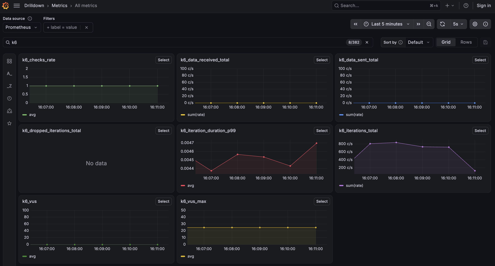
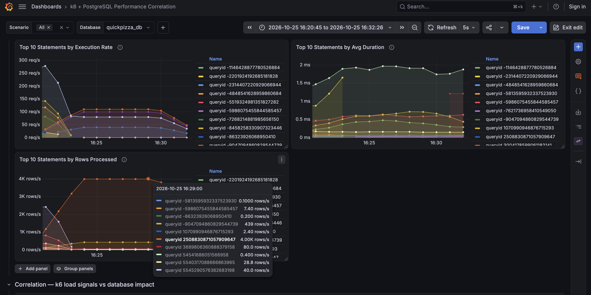

# Load testing the database

In this exercise, you'll learn how to:
- Write a load test against a database
- Send k6 results and PostgreSQL statistics to Prometheus and visualize performance in Grafana

The following architecture diagram shows the data flows used in this exercise within the Docker Compose setup.


-----

Open [`sql-db-k6-test.js`](./sql-db-k6-test.js) and review how it uses the `k6/x/sql` extension to interact with PostgreSQL.

This test runs three scenarios with different workload patterns:
- **Read-heavy**: list ingredients
- **Read**: random pizza lookup
- **Write**: insert a rating for a random seeded pizza

The `setup()` function prepares the test data and runs before the scenarios start. 

The `teardown()` function runs after the test completes and returns the database to its initial state.

Run the test with the `--out experimental-prometheus-rw` option to send k6 results to Prometheus. Run it from the repository root.

**k6 binary**

First tell k6 where Prometheus is listening:

```bash
# Linux and macOS
export K6_PROMETHEUS_RW_SERVER_URL=http://localhost:9090/api/v1/write
```

```powershell
# Windows (PowerShell)
$env:K6_PROMETHEUS_RW_SERVER_URL="http://localhost:9090/api/v1/write"
```

Then run the test:

```bash
k6 run --out experimental-prometheus-rw 5.infrastructure-testing/sql-db-k6-test.js
```

**Docker**

The `k6` container is already configured to reach Prometheus and PostgreSQL, so you can run the test directly:

```bash
docker compose exec k6 k6 run --out experimental-prometheus-rw 5.infrastructure-testing/sql-db-k6-test.js
```

> The test uses the `k6/x/sql` extension. k6 v1.2 or later downloads it automatically the first time you run the test, so the first run needs internet access and may take a moment to start.

The test runs for 10 minutes. While it runs, explore the results in Grafana.

> Metrics take a few minutes to appear. k6 sends its results every few seconds and PostgreSQL metrics are collected every 10 seconds, but the Prometheus data source in Grafana is configured with a 1-minute scrape interval, so the graphs show about one point per minute. Panels fill in gradually as the test runs, and a 10-minute run gives you around 10 points per panel.

## Explore the results in Grafana

### 1. Discover the metrics

Open [Metrics Drilldown](http://localhost:3000/a/grafana-metricsdrilldown-app/drilldown?from=now-15m&to=now&refresh=5s&var-ds=prometheus) to discover PostgreSQL and [k6 built-in metrics](https://grafana.com/docs/k6/latest/using-k6/metrics/reference/) as they arrive. The link shows the last 15 minutes and refreshes every 5 seconds. Type `k6` in the search box to filter the k6 metrics. You can also use **Explore** to query them.



### 2. Check the standard k6 dashboard

Open the **[k6 Prometheus Dashboard](http://localhost:3000/d/k6-prometheus/k6-prometheus?from=now-15m&to=now&refresh=5s)**. It is a standard dashboard designed for HTTP tests, so most of its panels are built from HTTP request data.

Because this test sends SQL queries instead of HTTP requests, the HTTP panels (requests, failures, request duration, latency and requests by URL) show **No data**. That is expected. Only the VUs and checks panels show data for this test.

### 3. Explore the PostgreSQL dashboard

Because this test generates database traffic instead of HTTP traffic, we asked Grafana Assistant to create a custom dashboard:

> Create a dashboard that correlates k6 load test results with PostgreSQL performance metrics collected through pg_stat_statements.
>
> Use the k6 Prometheus Dashboard as a reference (without native histograms).
>
> Include the k6 RED metrics like latency, error rate, request rate, VUs, and PostgreSQL performance  metrics
>
> The goal is to detect how the workload can affect DB bottlenecks and slow responses.


The dashboard was generated by Grafana Assistant and then provisioned for this demo.

Open the [k6 + PostgreSQL Performance Comparison](http://localhost:3000/d/k6-postgresql-performance/k6-2b-postgresql-performance-correlation?from=now-15m&to=now&refresh=5s) dashboard and explore how the k6 workload correlates with PostgreSQL performance metrics:

- Which scenario generates the most database activity?
- Do any failures or database locks occur?
- How do query latency and throughput change during the test?


> **Why do the VUs show 0 or 1?** This test uses the `constant-arrival-rate` executor, and every iteration is a single SQL query that takes a few milliseconds. k6 only counts the VUs that are running an iteration at the moment it takes a sample, so the whole workload (about 125 iterations per second) can run with a single VU, and the **Active VUs** value is mostly 0 or 1. **Max VUs Reached** shows the 25 VUs that k6 pre-allocated, which stay idle until they're needed. This means the database handles the load easily: with this model, look at the iteration rate and the database metrics, not the VUs.

Finally, explore the underlying k6 and `pg_stat_statements` metrics and queries. Try this challenge:

> **Which SQL statements process the most rows?** Duplicate the **Top 10 Statements by Execution Rate** panel and change it to rank the statements by rows processed instead.

<details>
<summary>Show the solution step by step</summary>

1. In the [k6 + PostgreSQL Performance Correlation](http://localhost:3000/d/k6-postgresql-performance/k6-2b-postgresql-performance-correlation?from=now-15m&to=now&refresh=5s) dashboard, expand the **PostgreSQL Performance** row.
2. Find the **Top 10 Statements by Execution Rate** panel. Open its menu (hover over the panel title) and select **More... > Copy**. Then click **Edit** at the top right of the dashboard, and use **Add > Paste panel** to add a copy of the panel.
3. Edit the pasted panel (open its menu and select **Edit**), and look at its query:

   ```promql
   topk(10, sum by(queryid) (rate(pg_stat_statements_calls_total{datname="$datname"}[$__rate_interval])))
   ```

   `pg_stat_statements_calls_total` counts how many times each statement is executed.

4. Change the metric to `pg_stat_statements_rows_total`, which counts the rows each statement returns or affects:

   ```promql
   topk(10, sum by(queryid) (rate(pg_stat_statements_rows_total{datname="$datname"}[$__rate_interval])))
   ```

5. The panel still uses the unit of the one you copied (requests per second), but these values are rows per second. In the panel options, go to **Standard options > Unit** and search for `rows` to select **rows/sec**.
6. Rename the panel to **Top 10 Statements by Rows Processed**, and go back to the dashboard.
7. One statement processes far more rows than all the others. Hover over its line to see its `queryid`. Is it also the statement that runs most often in **Top 10 Statements by Execution Rate**? Check **Top 10 Statements by Avg Duration** to see whether it is also slow.

> Pre-provisioned dashboards can't be saved. At most, you can use **Save as copy** to save your changes under a new name. For the workshop you don't need to save: you can still see and use the new panel while the dashboard is open.

The result looks like this:



</details>


## Optional: explore with Grafana Assistant

This step is optional. You can connect your local Grafana to [Grafana Assistant](https://grafana.com/docs/grafana-cloud/platform/grafana-assistant/get-started/self-managed/) in Grafana Cloud, the tool we used to generate the PostgreSQL dashboard, and ask it questions about your k6 and PostgreSQL metrics.

1. Create a [free Grafana Cloud account](https://grafana.com/auth/sign-up/create-user) if you don't have one. The free tier includes Grafana Assistant. See the [pricing page](https://grafana.com/pricing/#grafana-assistant) for the usage limits.
2. Follow the documentation: [Enable Assistant in Grafana OSS](https://grafana.com/docs/grafana-cloud/platform/grafana-assistant/get-started/self-managed/). You'll install the Grafana Assistant plugin in your local Grafana ([localhost:3000](http://localhost:3000/)) and connect it to your Grafana Cloud stack. The local Grafana in this workshop meets the version requirement.

> The connection flow sends your local Grafana URL to Grafana Cloud. Skip this step if you prefer not to share it.

No Grafana Cloud account? Explore [play.grafana.org](https://play.grafana.org/), the public Grafana demo environment, to see more example dashboards and what you can build with Grafana.

## Related Resources

- [github.com/grafana/xk6-sql](https://github.com/grafana/xk6-sql)
- [k6 Documentation: Test lifecycle](https://grafana.com/docs/k6/latest/using-k6/test-lifecycle/)
- [k6 Documentation: Built-in metrics](https://grafana.com/docs/k6/latest/using-k6/metrics/reference/)
- [k6 Documentation: Send k6 results to Prometheus](https://grafana.com/docs/k6/latest/results-output/real-time/prometheus-remote-write/)
- [Grafana Assistant Documentation: Enable Assistant in Grafana OSS](https://grafana.com/docs/grafana-cloud/platform/grafana-assistant/get-started/self-managed/) (requires a Free Grafana Cloud account).


---

[← Previous exercise](../4.assertions/) · [Workshop homepage](https://github.com/immavalls/cnd-norway-2026-k6-workshop) · [Next exercise →](../6.operator/)